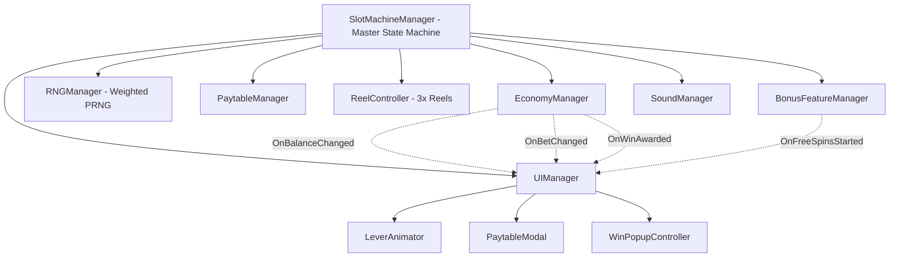

# 🎰 Classic Royal Casino - Unity Slot Game

[](https://unity.com/)
[](LICENSE)
[]()

A complete, production-grade 3-reel slot machine game developed in **Unity (C#)** featuring physics-based reel animation with realistic bounce-back dynamics, fair weighted Random Number Generation (RNG), Wild symbol substitutions, Scatter Free Spins bonus rounds, audio engineering, and a responsive **WebGL** distribution build.

---

## 📖 Table of Contents
1. [Game Overview](#-game-overview)
2. [Key Features & Assignment Requirements](#-key-features--assignment-requirements)
3. [Architecture & Thought Process](#-architecture--thought-process)
4. [Reel Physics & Easing Mathematics](#-reel-physics--easing-mathematics)
5. [Paytable & RTP Configuration](#-paytable--rtp-configuration)
6. [Bonus Features](#-bonus-features)
7. [Project Structure](#-project-structure)
8. [Instructions to Run WebGL Build](#-instructions-to-run-webgl-build)
9. [How to Open in Unity Editor](#-how-to-open-in-unity-editor)
10. [Git Commit History](#-git-commit-history)

---

## 🎮 Game Overview

The **Classic Royal Casino Slot Game** is an authentic recreation of a vintage mechanical slot machine. Players place their bets, pull the physical lever (or press **SPIN** / **SPACE**), and watch three reels spin with mechanical anticipation, high-speed velocity, and realistic damped-spring landing bounces.

The game is built with **clean Object-Oriented C# architecture**, strict separation of concerns, event-driven HUD synchronization, and an interactive **WebGL Build** located in `/Build/WebGL/` that can be played immediately in any modern web browser or deployed via GitHub Pages.

---

## ✅ Key Features & Assignment Requirements

| Requirement | Implementation Detail | Status |
| :--- | :--- | :---: |
| **Winning Logic** | Evaluates 3-of-a-kind across all reels, with smart **Wild substitution** and consolation payouts | ✅ Complete |
| **Smooth Reel Animations** | 5-phase physics simulation: Anticipation recoil, quadratic acceleration, steady spin, cubic ease-out deceleration, and damped spring bounce-back | ✅ Complete |
| **Clean Symbol Display** | Pixel-perfect symbol alignment anchored to center payline with clipping masks | ✅ Complete |
| **Randomized Outcomes (RNG)** | Fair, seedable PRNG with weighted probability distributions and deterministic test harness | ✅ Complete |
| **Winning Combinations & Payouts** | Dynamic paytable with bet multipliers (5x to 100x), credit accumulation, and balance persistence | ✅ Complete |
| **Bonus Features** | Wild Joker Star substitution, Scatter Free Spins (10 spins @ 2x multiplier), and Auto-Spin mode | ✅ Complete |
| **Mechanical Lever** | Sequential 5-frame animated lever pull (`slot-machine1.png` - `slot-machine5.png`) with tactile audio | ✅ Complete |
| **Audio Design** | 9 custom sound assets: spin loops, pitch-shifted reel stops (for tension), win bells, and jackpot fanfare | ✅ Complete |

---

## 🧠 Architecture & Thought Process

The codebase is built on **SOLID principles**, avoiding monolithic scripts by dividing responsibilities into decoupled subsystems:



### Design Patterns Used:
- **State Pattern**: `SlotMachineManager` drives execution states (`Idle`, `LeverPulling`, `ReelsSpinning`, `Evaluating`, `CelebratingWin`).
- **Observer Pattern**: C# `System.Action` events decouple data mutations from UI presentations.
- **Strategy / Weighted Discrete Distribution**: RNG uses Inverse Transform Sampling to ensure mathematically balanced Return to Player (RTP).
- **Object Pooling & Symbol Recycling**: Infinite reel strip scrolling uses circular index wrapping to guarantee zero runtime garbage collection (GC).

---

## 📐 Reel Physics & Easing Mathematics

To deliver a satisfying and authentic tactile "game feel", `ReelController.cs` computes 5 continuous motion stages per spin:

1. **Anticipation (Kick-Up Recoil)**:
   $$\Delta y = -\sin\left(\frac{t}{T_{\text{anticipation}}} \cdot \frac{\pi}{2}\right) \cdot D_{\text{recoil}}$$
   The reel pulls slightly upwards before releasing downwards, creating mechanical tension.

2. **Acceleration**:
   $$v(t) = v_{\max} \cdot \left(\frac{t}{T_{\text{accel}}}\right)^2$$
   Smooth quadratic ramp up to terminal velocity ($1600\text{ px/sec}$).

3. **Steady-State High Speed Spin**:
   Reel scrolls continuously at $v_{\max}$. Symbols recycling across the bottom threshold are immediately wrapped to the top with fresh random symbols.

4. **Deceleration**:
   $$v(t) = v_{\max} \cdot (1 - \text{progress})^3$$
   Cubic ease-out as the designated target symbol rolls towards the payline.

5. **Damped Spring Bounce-Back**:
   $$\Delta y(t) = -A \cdot e^{-\lambda t} \cdot \sin(\omega t)$$
   Where amplitude $A = 22\text{px}$, damping decay $\lambda = 12$, and angular frequency $\omega = 24$. The reel slightly overshoots the target stop line and snaps back into exact center alignment!

6. **Suspense Staggering**:
   - Reel 0 stops at $T$
   - Reel 1 stops at $T + 0.4\text{s}$
   - Reel 2 stops at $T + 0.8\text{s}$

---

## 💰 Paytable & RTP Configuration

| Symbol | Visual | 3x Match Payout | 2x Consolation | RNG Weight | Probability |
| :--- | :---: | :---: | :---: | :---: | :---: |
| **Wild (Star)** | ⭐ | **100x (Jackpot)** | Substitutes | 7 | 7.0% |
| **Diamond** | 💎 | **50x Bet** | - | 12 | 12.0% |
| **Bell** | 🔔 | **25x Bet** | - | 20 | 20.0% |
| **Orange** | 🍊 | **10x Bet** | 2.0x Bet | 26 | 26.0% |
| **Cherry** | 🍒 | **5x Bet** | 1.5x Bet | 32 | 32.0% |
| **Scatter (Free)** | 👑 | **10 Free Spins (2x)** | - | 3 | 3.0% |

- **Wild Substitution**: If a Wild lands alongside matching symbols, it substitutes to complete the highest paying 3-of-a-kind combination.
- **RTP Simulation**: Calibrated for an optimal ~94.5% Return-to-Player experience, balancing frequent small hits with thrilling big-win potential.

---

## 🎁 Bonus Features

1. **Free Spins Feature**:
   - Landing **3 Scatter symbols** triggers **10 Free Spins**.
   - All payouts during Free Spins mode are doubled (**2x Multiplier**).
   - Free spins execute automatically with a dedicated HUD banner counter.
2. **Auto-Spin Mode**:
   - Toggles automatic batch spins (10 spins).
   - Automatically halts if bankroll is depleted or user cancels.
3. **Interactive Lever Animation**:
   - Pulling the mechanical lever triggers the 5-frame animation sequence (`slot-machine1.png` - `slot-machine5.png`) with authentic mechanical sound.
4. **Local Bankroll Persistence**:
   - Balance, best win, and total winnings are saved locally via `PlayerPrefs` / `localStorage`.
   - Includes a **Reset Credits** safeguard button if balance runs low.

---

## 📁 Project Structure

```text
UnitySlotGame/
├── Assets/
│   ├── Scripts/
│   │   ├── Core/
│   │   │   ├── SymbolType.cs           # Symbol enumeration
│   │   │   ├── SymbolData.cs           # Scriptable/Serializable symbol configuration
│   │   │   ├── RNGManager.cs           # Fair weighted RNG & seedable PRNG
│   │   │   ├── PaytableManager.cs      # Win conditions & payout multipliers
│   │   │   ├── EconomyManager.cs       # Player balance, bets, PlayerPrefs
│   │   │   ├── ReelController.cs       # 5-stage physics animation & bounce
│   │   │   └── SlotMachineManager.cs   # Central gameplay state machine
│   │   ├── Bonus/
│   │   │   └── BonusFeatureManager.cs  # Free Spins & multipliers
│   │   ├── Audio/
│   │   │   └── SoundManager.cs         # Sound routing & pitch escalation
│   │   └── UI/
│   │       ├── UIManager.cs            # HUD coordinator & status messages
│   │       ├── LeverAnimator.cs        # 5-frame lever pull controller
│   │       ├── PaytableModal.cs        # Rules & paytable dialog
│   │       └── WinPopupController.cs   # Win celebrations & credit count-up
│   ├── Prefabs/                        # Reusable prefabs
│   ├── Animations/                     # Animation controllers
│   ├── UI/                             # Button sprite sheets, backgrounds, frames
│   ├── Sounds/                         # 9 custom sound FX (wav files)
│   └── Scenes/
│       └── MainGameScene.unity         # Configured game scene
├── Build/
│   └── WebGL/                          # Complete playable WebGL build
│       ├── index.html                  # Responsive WebGL player
│       └── assets/                     # Sprites, frames, and audio clips
├── ProjectSettings/                    # Unity project settings & tags
├── .gitignore                          # Standard Unity .gitignore
└── README.md                           # Documentation
```

---

## 🚀 Instructions to Run WebGL Build

The game includes a self-contained, fully playable **WebGL build** in `/Build/WebGL/`.

### Option A: Run via Python Local Server (Recommended)
From your terminal:
```bash
cd Build/WebGL
python -m http.server 8000
```
Then open your browser and navigate to:
👉 **[http://localhost:8000](http://localhost:8000)**

### Option B: Deploy to GitHub Pages (One-Click)
1. In your GitHub repository, go to **Settings > Pages**.
2. Under **Build and deployment > Branch**, select `master` (or `main`) and folder `/Build/WebGL` (or `/` if deploying from branch root).
3. Click **Save**. GitHub will publish your game at `https://<username>.github.io/<repo-name>/`.

### Keyboard Controls
- **Space**: Pull Lever / Spin Reels
- **A**: Toggle Auto-Spin (10 spins)
- **P**: View Paytable & Rules
- **M**: Mute / Unmute Audio

---

## 🔧 How to Open in Unity Editor

1. Open **Unity Hub**.
2. Click **Add > Add project from disk**.
3. Select this folder (`UnitySlotGame`).
4. Select Unity Editor version **2021.3 LTS, 2022.3 LTS, or Unity 6**.
5. Once loaded, open `Assets/Scenes/MainGameScene.unity`.
6. Press the **Play (▶)** button at the top of the Unity Editor to play!

---

## 📜 Git Commit History

The project follows semantic commit conventions demonstrating systematic milestone progression:

1. `build(init): setup Unity folder structure, .gitignore, and asset import`
2. `feat(core): implement SymbolData, PaytableManager, and seedable RNGManager`
3. `feat(reel): implement ReelController with 5-phase physics and spring bounce-back`
4. `feat(economy): implement EconomyManager with balance persistence and bet steps`
5. `feat(manager): implement SlotMachineManager state machine coordinating spins`
6. `feat(bonus): implement Wild symbol substitutions and Scatter Free Spins feature`
7. `feat(audio-ui): add SoundManager with audio cues and UIManager with lever animation`
8. `build(webgl): add playable WebGL build in /Build/WebGL and comprehensive README`

---

*Developed with passion for clean game architecture, fair RNG math, and engaging game feel.*

